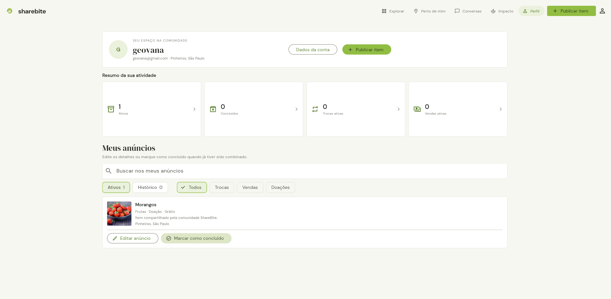

# ShareBite

Aplicativo Flutter demonstrativo para compartilhar, trocar e encontrar alimentos e outros itens no bairro. A comunidade pode publicar anúncios, encontrar itens próximos, conversar sobre uma publicação e acompanhar seus anúncios pelo perfil.

## Capturas de tela

### Explorar


### Perfil



## Tecnologias

- **Dart e Flutter** para a aplicação multiplataforma.
- **SQLite** com `sqflite` para persistir perfil demonstrativo, anúncios, favoritos e conversas.
- **SQLite no navegador** via `sqflite_common_ffi_web` e WebAssembly; no Flutter Web, os dados ficam no armazenamento local do navegador (IndexedDB).
- **ChangeNotifier** para notificar a interface sobre alterações de estado.
- **Repository pattern** para separar o controller da implementação SQLite.
- `geolocator` para solicitar a localização do dispositivo.
- `image_picker` para selecionar fotos.
- `google_fonts` para tipografia.
- `flutter_test` e `flutter_lints` para testes e análise estática.

O SQLite é local: os dados não são sincronizados entre dispositivos, navegadores ou origens/portas diferentes. O acesso à conta é demonstrativo e não verifica credenciais em um servidor.

## Como executar

### Requisitos

- Flutter SDK instalado e configurado.
- Google Chrome para executar a versão Web.

Na raiz do projeto, instale as dependências e inicie o app:

```powershell
flutter pub get
flutter run -d chrome --web-port 8084
```

Use a mesma porta ao reabrir a aplicação no navegador: a persistência Web é separada por origem, então `localhost:8084` e `localhost:8085` têm armazenamentos distintos.

Para executar os testes e verificar o código:

```powershell
flutter test
flutter analyze
```

Para gerar a versão Web de produção:

```powershell
flutter build web --release
```

Os recursos `web\sqlite3.wasm` e `web\sqflite_sw.js` já estão incluídos. Se precisar regenerá-los depois de instalar as dependências:

```powershell
dart run sqflite_common_ffi_web:setup
```

### Plataformas móveis

Para criar os diretórios nativos Android e iOS, caso ainda não existam:

```powershell
flutter create --platforms=android,ios .
```

O pacote `geolocator` precisa das permissões de localização configuradas na plataforma. Na Web, a localização requer HTTPS ou `localhost` e autorização do navegador.

## Funcionalidades

- Busca, filtros por categoria e modalidade, detalhes e itens salvos.
- Publicação e edição de anúncios com foto, descrição, categoria, modalidade e localização.
- Perfil com dados demonstrativos, anúncios ativos e histórico.
- Conversas demonstrativas sobre anúncios, com mensagens persistidas localmente.
- Localização do dispositivo e mapa ilustrativo.
- Painel demonstrativo de impacto e rede de parceiros.

## Organização do código

- `lib/main.dart`: inicialização do Flutter.
- `lib/screens/sharebite_app.dart`: telas, navegação e widgets da interface.
- `lib/controllers/sharebite_controller.dart`: estado compartilhado e regras de interação, notificados à interface com `ChangeNotifier`.
- `lib/data/sharebite_repository.dart`: contrato e implementação que conectam o controller aos dados.
- `lib/data/sharebite_database.dart`: abertura do SQLite e operações de baixo nível.
- `lib/models/sharebite_models.dart`: modelos e conversões entre modelos e registros.
- `lib/data/sample_data.dart`: dados iniciais e categorias demonstrativas.
- `test/`: testes dos modelos e do controller.

A interface depende do controller; o controller depende do contrato do repositório; apenas a implementação do repositório acessa o SQLite.

## Integrantes

- Geovana Apolinario de Souza
- Leticia de Souza
- Pablo Henrique Rodrigues de Oliveira
- Vitor Gabriel Cardoso dos Santos

```powershell
git log --all --format="%h %an <%ae> %s"
```
